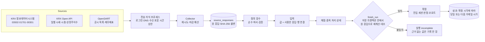
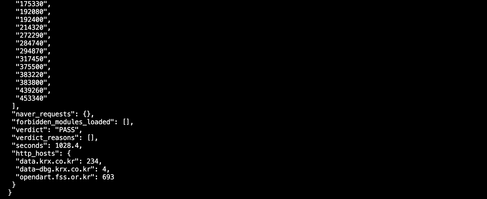
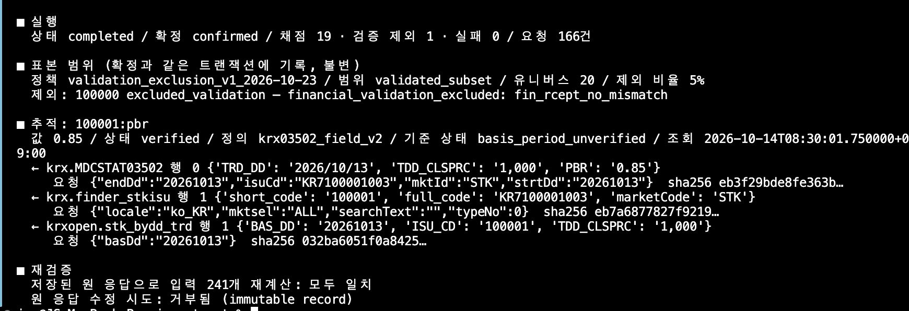

# Investment Console — KRX·DART 데이터의 원천 추적과 재검증 파이프라인

KRX·DART 원천 데이터를 수집해 가치·품질 점수를 계산하고, **"이 신호가 언제, 어떤 원 데이터로 만들어졌는가"를 끝까지 추적·재검증**할 수 있게 만든 개인 프로젝트입니다.

처음 목표는 종목 스크리너였지만, 검증 과정에서 **데이터를 믿을 수 없으면 어떤 전략 결과도 의미가 없다**는 것을 확인했습니다. 그래서 프로젝트의 중심을 신뢰할 수 있는 데이터 파이프라인으로 옮겼습니다.

> 상태: 공식 입력 경로는 **격리 환경에서 구현·검증 완료**(감독기 PASS), 운영 전환은 보류 중입니다. 투자 성과를 주장하는 프로젝트가 아닙니다(아래 "결과" 참조).

---

## 핵심 설계



| 문제 | 설계 | 위치 |
|---|---|---|
| 같은 숫자가 어느 원 데이터에서 왔는지 알 수 없음 | 원 응답을 압축·해시와 함께 **추가 전용**으로 보존하고, 입력마다 사용한 응답·행을 연결 | `database/signal_store.py` |
| 수집 시 계산과 저장된 값이 어긋날 수 있음 | 수집과 저장 시점 재검증이 **같은 순수 함수**를 사용. 저장 트랜잭션 안에서 원 응답을 다시 파싱해 값·결측 종류·실패 사유·시점을 전부 대조 | `analyzer/pipeline/sources.py`, `dart_inputs.py` |
| 미래 정보 누출(look-ahead) | 장 시작 전 실행은 직전 확정 세션만 사용. 진입가는 신호 확정 이후의 시가 — 장전 마감 안에 확정되면 당일 시가, 아니면 다음 거래일 시가. 재무는 공시 접수번호·접수일·최신 정정 버전으로 시점 확인 | `analyzer/pipeline/entry.py`, `dart_select.py` |
| 결측과 조회 실패가 섞임 | `"-"`·빈 값(원천 결측) / 응답 없음·불일치(실패)를 구분. 실패는 0이나 빈 값으로 넘기지 않고 종목 처리 실패 | `sources.parse_number`, `collect.make_input` |
| 일부 종목 문제로 전체가 멈춤 vs 문제를 숨김 | 공시 검증 실패는 **제외 사유와 함께 기록**(상한 5%), 통신·저장 오류는 실행 미완료 | `official.apply_financial_status` |
| 네트워크 지연으로 마감 초과 | 전송을 자식 프로세스로 분리하고 부모가 단조 시계로 감독, 초과 시 자식만 종료하고 늦은 응답은 저장하지 않음 | `analyzer/pipeline/transport_proc.py` |
| 오래된 DB에 새 코드가 조용히 섞임 | 스키마가 다르면 자동 변경 없이 거부 | `SignalStore.initialize` |
| 잘못된 휴장일 달력 | 달력 버전마다 시험/공식 구분을 불변 기록, 공식은 승인 근거 필수 | `database/trading_calendar.py` |

---

## 설계 판단 세 가지

**1. 저장된 판정을 믿지 않고 원 응답으로 다시 계산한다.**
수집할 때 계산한 값은 그 순간의 코드·응답에 대한 주장일 뿐입니다. 저장 트랜잭션 안에서 보존된 원 응답을 같은 함수로 다시 해석해 값·결측 종류·실패 사유·시점이 모두 일치할 때만 기록합니다. 그래서 파서가 바뀌거나 응답이 변조되면 조용히 섞이지 않고 실행이 미완료로 남습니다.

**2. 스레드가 아니라 전송 전용 프로세스로 마감을 보장한다.**
스레드에서 기다림을 멈춰도 로그인·DNS·HTTP 작업은 계속 돌고, 공유 세션이 뒤늦게 바뀔 수 있습니다. 전송을 자식 프로세스로 분리하면 부모가 단조 시계로 시간을 재다가 그 자식만 종료할 수 있고, 늦거나 불완전한 응답은 애초에 부모에게 저장되지 않습니다. (multiprocessing spawn이 부모 스크립트를 자식에서 다시 실행하는 문제도 이 과정에서 발견해 독립 모듈 실행으로 바꿨습니다.)

**3. 데이터 검증 실패와 실행 오류를 다르게 처리한다.**
공시 접수번호 불일치처럼 "데이터가 검증 조건을 만족하지 않음"은 그 종목만 사유와 함께 제외하고(전체의 5% 상한), 통신 실패·요청 한도·저장 오류처럼 "실행이 제대로 되지 않음"은 실행 전체를 미완료로 둡니다. 한 종목 때문에 관찰이 무기한 멈추는 것도, 실행 오류를 제외로 숨기는 것도 막기 위해서입니다.

## 실제로 찾아 막은 데이터 문제

| 발견한 문제 | 영향 | 대응 |
|---|---|---|
| pykrx가 KRX의 결측 표기 `"-"`를 `0`으로 변환 | 적자 PER이 0으로 들어가 점수 왜곡 | 원 응답을 직접 파싱 |
| 2026-09-14부터 Naver 수정종가가 KRX 종가와 어긋남(110/114 종목, 원인 미확인) | 두 원천의 가격 기준 불일치 — 변동성 입력이 어느 기준인지 불분명 | KRX 등락률(FLUC_RT)로 원천 교체, 그 이전 29,383 종목·일 대조 |
| 2026-08-26~09-01 5거래일 일봉 통째로 누락 | 성과 평가 창이 5일 어긋남 | 수집 구조 원인 기록, 공식 경로는 공지 기반 달력 사용 |
| 거래정지 137일 동안 0% 등락이 변동성에 포함 | 리스크 점수 만점으로 과대평가 | 장기·기준일 정지 종목 차단 (v8.6.9) |
| DART 첨부정정 공시로 재무 API 접수번호가 목록과 불일치 | 정정 전 수치를 최신으로 오인 가능 | 접수번호 검증, 원문 대조를 거친 사례만 승인 목록에 등록 |
| Naver 재무 API가 날짜 인자를 무시하고 항상 현재값 반환 | 과거 연구 전체에 미래 정보 누출 | 코드 수준으로 확인·기록, DART 경로로 교체 |
| 장중 실행 신호를 같은 날 시가에 산 것으로 기록 | 성과 과대평가 | 실행 시각 기준 진입 규칙(당일/익일 시가) 고정 |
| `git status`가 실행 중 `.git/index`를 갱신 | 보호 파일 감시 실패 | 조회에 `GIT_OPTIONAL_LOCKS=0` |

---

## 검증 방식

- **테스트**: `pytest` 396개 통과 (엔진 v8.6.9, GitHub Actions에서 Python 3.10·3.11 자동 실행) — 파서 경계값, 원 응답 변조 감지, 다른 실행의 응답 참조 거부, 마감 초과(재로그인·DNS 정지·느린 응답 주입), 달력 구분 위장 등.
- **격리 실행 + 감독기**: 실제 114종목 전체 실행을 격리 DB에서 돌리고, 감독기가 프로젝트 파일 8,500여 개의 해시를 실행 전후로 비교. 2026-10-23 실행: 109종목 채점·5종목 검증 제외, 응답 927개 재검증 일치, Naver 요청 0건, 약 17분.

  
- **연구 사전등록**: 가설·지표·기준값을 결과 전에 문서에 고정(`docs/RESEARCH.md`). 결과를 본 뒤 기준을 바꾸지 않음.

## 결과와 그 한계

- 과거 데이터(2026년 1~7월)로 한 연구는 이 점수의 상위 종목이 KOSPI보다 낫다는 근거를 보여 주지 못했습니다. 다만 **그 연구 자체를 믿을 수 없게 된 것이 이 프로젝트의 핵심 발견**입니다: 실적·리스크 입력이 날짜 인자를 무시하는 Naver API의 *현재값*으로 계산돼 미래 정보가 섞여 있었습니다(코드 수준 확인). 그래서 과거 수치는 검증된 성과로 쓰지 않고, 시점이 확인된 원천으로 다시 기록을 시작하도록 파이프라인을 다시 만들었습니다.
- 시험한 단순 수급 규칙들은 점수 편입 근거를 확보하지 못해 제거했습니다(일부 조건부 관찰은 연구 기록으로만 남김). 모멘텀 순위도 채택 근거를 얻지 못했습니다.
- 이 저장소는 투자 성과를 주장하지 않습니다. 가치는 **전략이 통하는지를 믿을 수 있게 확인할 수 있는 데이터 기반**에 있습니다.

---

## 구조

```
analyzer/pipeline/   공식 입력 경로: 전송·수집·원천 정의·DART 재무·진입 판정·실행 조정
database/            SQLite 저장소(신호·원 응답·달력·가격), 불변 트리거
analyzer/scoring/    가치·실적·리스크 점수
analyzer/data/       현행(콘솔용) 데이터 수집
pages/, app.py       Streamlit 콘솔
research/            연구 스크립트
tests/               pytest
docs/                설계(design/signal_pipeline.md)·연구 기록·아키텍처
```

## 실행

```bash
pip install -r requirements.txt
python -m pytest -q tests              # 네트워크·API 키 불필요 (가짜 전송 사용)
python scripts/demo_pipeline.py        # 파이프라인 전 구간 데모
```

데모는 고정 데이터(20종목, 1종목은 DART 기초 보고서 접수번호 불일치)로 실행·확정까지 돌린 뒤, 숫자 하나의 출처를 원 응답의 행까지 따라갑니다.



<details>
<summary>출력 텍스트</summary>

```
■ 실행
  상태 completed / 확정 confirmed / 채점 19 · 검증 제외 1 · 실패 0 / 요청 166건
■ 표본 범위 (확정과 같은 트랜잭션에 기록, 불변)
  정책 validation_exclusion_v1_2026-10-23 / 범위 validated_subset / 유니버스 20 / 제외 비율 5%
  제외: 100000 excluded_validation — financial_validation_excluded: fin_rcept_no_mismatch
■ 추적: 100001:pbr
  값 0.85 / 상태 verified / 정의 krx03502_field_v2 / 기준 상태 basis_period_unverified
  ← krx.MDCSTAT03502 행 0 {'TRD_DD': '2026/10/13', 'TDD_CLSPRC': '1,000', 'PBR': '0.85'}
  ← krx.finder_stkisu 행 1 {'short_code': '100001', 'full_code': 'KR7100001003', 'marketCode': 'STK'}
  ← krxopen.stk_bydd_trd 행 1 {'BAS_DD': '20261013', 'ISU_CD': '100001', 'TDD_CLSPRC': '1,000'}
■ 재검증
  저장된 원 응답으로 입력 241개 재계산: 모두 일치
  원 응답 수정 시도: 거부됨 (immutable record)
```

</details>

PBR 하나가 ① 그날 03502 응답의 행, ② 종목코드→ISIN 연결 행, ③ 같은 날 Open API 종가 대조 행 세 근거로 검증된 값임을 보여 줍니다. 실제 수집에는 환경 변수 `KRX_ID`, `KRX_PW`, `KRX_OPEN_API_KEY`, `DART_API_KEY`가 필요합니다(`.env`, 저장소에 포함되지 않음).

## 기술

Python 3.10+ (개발 3.11) · SQLite(불변 트리거·복합 외래 키) · pandas · requests · Streamlit · pytest
